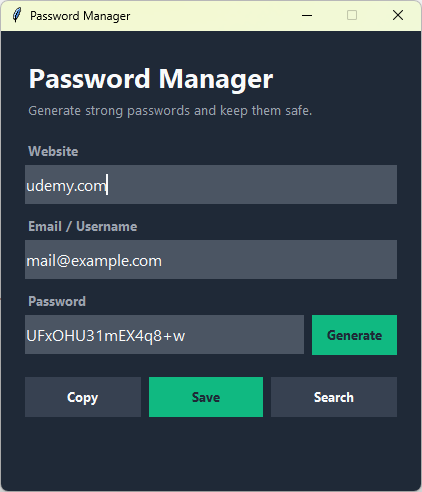

# Password Manager
A small Tkinter app that generates secure passwords, stores them in a JSON file, and lets you search saved entries.

## What I Practiced
- Building a form-based GUI with `tkinter` (grid layout, `StringVar`, `messagebox`).
- Generating cryptographically secure passwords with the `secrets` module.
- Reading and writing JSON with `json.dump` / `json.load`.
- Handling missing or corrupted data files gracefully.
- Using `str.strip()` for input validation before saving.
- Copying text to the system clipboard with `clipboard_clear` / `clipboard_append`.
- Anchoring paths to the script location with `Path(__file__).resolve().parent`.
- Binding keyboard shortcuts (`Enter`, `Escape`) at the window level.

## Controls
| Input | Action |
|-------|--------|
| `Generate` | Fill the password field with a fresh 16-character password |
| `Copy` | Copy the current password to the clipboard |
| `Save` | Save the entry (website / email / password) to `data.json` |
| `Search` | Look up a website and fill the form with its saved data |
| `Enter` | Same as `Save` |
| `Esc` | Quit |

## How to Run
1. Make sure Python 3 is installed (Tkinter ships with it).
2. Navigate to the `day_029_password_manager` folder.
3. Run the script:
   ```bash
   python main.py
   ```

## Screenshot

